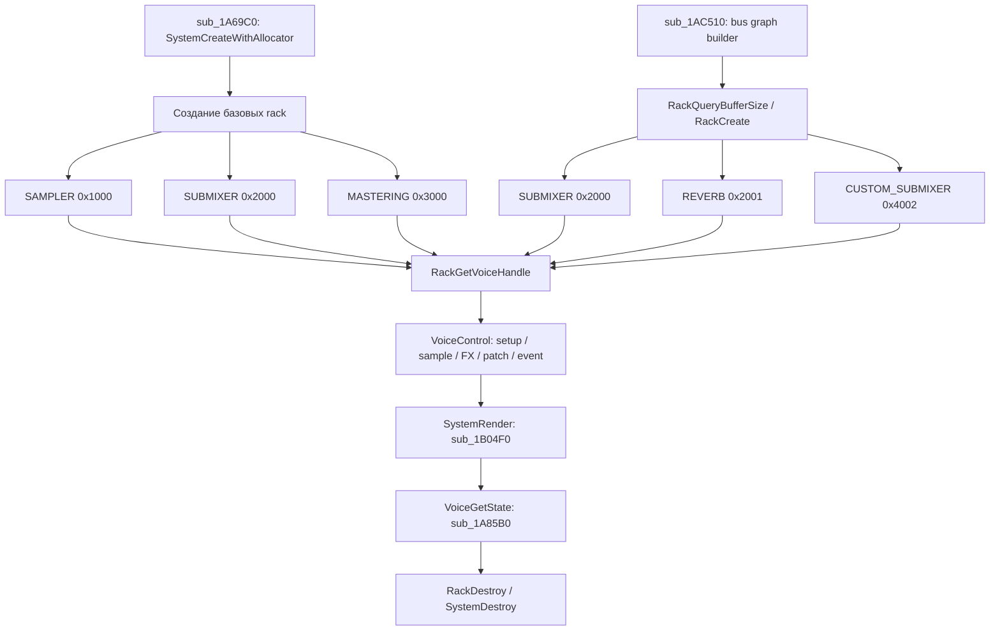

# NGS2: полная карта вызовов EBOOT и аудит совместимости HLE

> Дата анализа: 2026-11-01. Бинарник: `eboot.elf`, image base `0`, IDA 7.0 / IDAPython.  
> Статический отчёт: [NGS2_CALL_MAP.md](NGS2_CALL_MAP.md), исходные данные: [JSON](eboot.elf.ngs2_static.json), [CSV](eboot.elf.ngs2_static.csv).  
> Проверенная реализация: [GFOXSH/tlg_pc, branch ngs2](https://github.com/GFOXSH/tlg_pc/tree/ngs2), HEAD `685e4e1d5d69c64357dd364c17de0202a89a41ed`.

## 1. Резюме

В бинарнике обнаружены **238 прямых call site** к **10 импортам NGS2**, вызываемых из **20 функций**. Группировщик дал 42 варианта сигнатур. Главный центр управления аудио — `VoiceControl` (111 вызовов) и `RackGetVoiceHandle` (86 вызовов): вместе 197/238 (82,8%).

Эти цифры — количество статических call site, а не runtime-частота. Они не доказывают, что каждая ветвь исполняется в одном прохождении игры.

| API | Call site | Функций-вызывателей | NID |
|---|---:|---:|---|
| `sceNgs2SystemCreateWithAllocator` | 1 | 1 | `mPYgU4oYpuY` |
| `sceNgs2SystemDestroy` | 2 | 2 | `u-WrYDaJA3k` |
| `sceNgs2SystemRender` | 1 | 1 | `i0VnXM-C9fc` |
| `sceNgs2RackQueryBufferSize` | 11 | 1 | `0eFLVCfWVds` |
| `sceNgs2RackCreate` | 11 | 1 | `cLV4aiT9JpA` |
| `sceNgs2RackCreateWithAllocator` | 4 | 1 | `U546k6orxQo` |
| `sceNgs2RackDestroy` | 9 | 3 | `lCqD7oycmIM` |
| `sceNgs2RackGetVoiceHandle` | 86 | 17 | `MwmHz8pAdAo` |
| `sceNgs2VoiceControl` | 111 | 15 | `uu94irFOGpA` |
| `sceNgs2VoiceGetState` | 2 | 1 | `-TOuuAQ-buE` |
| **Итого** | **238** | **20 уникальных функций** | **10 NID** |

NID сопоставлены через таблицу импортов игры и `port/src/import_names.inc`, а не по строкам в .text: сканер не обнаружил текстовых NID в самом EBOOT.

## 2. Общий граф и жизненный цикл



### 2.1 Инициализация

`sub_1A69C0` — базовая инициализация:

- `SystemCreateWithAllocator`: 1 site, `0x1A7656`.
- `RackCreateWithAllocator`: 4 sites:
  - MASTERING `0x3000`: `0x1A76F1`;
  - SUBMIXER `0x2000`: `0x1A7773`, `0x1A78E6`;
  - SAMPLER `0x1000`: `0x1A7828`.
- Далее получает voice handles и настраивает rack через `VoiceControl`: setup, output, PATCH, KICK_EVENT и матрицы.
- В cleanup-ветви: 4 `RackDestroy` и 1 `SystemDestroy`.

### 2.2 Построитель bus-графа

`sub_1AC510` содержит все 11 sites `RackQueryBufferSize` и все 11 sites `RackCreate`. ID перед вызовами восстановлены непосредственно из `EDI/ESI`:

| Rack ID | Назначение | Query | Create |
|---:|---|---:|---:|
| `0x2000` | SUBMIXER | 7 | 7 |
| `0x2001` | REVERB | 1 | 1 |
| `0x4002` | CUSTOM_SUBMIXER | 3 | 3 |
| **Итого** | | **11** | **11** |

Все точные адреса создания/запроса — в разделе 7 ниже. В сочетании с четырьмя allocator-созданиями это 15 статических sites создания rack.

**Блокирующая находка для текущего HLE:** EBOOT явно создаёт `CUSTOM_SUBMIXER (0x4002)` три раза. В `tlg_pc/ngs2/port/src/ngs2/Ngs2Exports.cpp` функция `RackTailWords()` знает только SAMPLER, SUBMIXER, MASTERING и REVERB; для `0x4002` срабатывает `ngs2_stop("... rack id ... is not translated")`. Это происходит в PS4→PS5 адаптере раньше, чем управление попадает в движок.

При этом `port/src/ngs2/Rack.cpp` на стороне AnyPS5 уже содержит `Ngs2CustomSubmixerRackOption`, `RackOptionSize(CUSTOM_SUBMIXER)` и проверку custom rack. Следовательно, задача — не написать тип rack с нуля, а восстановить и перевести **PS4 layout/options 0x4002** в уже существующий PS5 layout. Старое native trace-исследование фиксировало размер PS4 custom rack option `0x4D8`; точную раскладку tail и каждого module option надо подтвердить по EBOOT/trace, а не копировать произвольным числом dword.

### 2.3 Создание, удаление и render

| Действие | Call sites | Адреса / caller |
|---|---:|---|
| System create | 1 | `sub_1A69C0: 0x1A7656` |
| Rack create (allocator) | 4 | `sub_1A69C0: 0x1A76F1, 0x1A7773, 0x1A7828, 0x1A78E6` |
| Rack query/create bus | 11 + 11 | `sub_1AC510`, полный список ниже |
| Rack destroy | 9 | `sub_1A69C0` (4), `sub_1A83A0` (4), `sub_1ADB70` (1) |
| System destroy | 2 | `sub_1A69C0` (1), `sub_1A83A0` (1) |
| System render | 1 | `sub_1B04F0: 0x1B064C` |

`SystemRender` вызывается один раз из `sub_1B04F0`. Буферный массив адресуется через локальную структуру на стеке, количество буферов приходит регистром (`R12D` в последнем восстановленном определении). Сам call site не доказывает runtime-количество выходов и их форматы. Отдельные native trace-заметки для TLG сообщают основной выход float32, 8 каналов, grain 256 samples, 48 kHz; это динамическое свидетельство, не вывод только из этого вызова.

## 3. RackGetVoiceHandle и voice lifecycle

Всего 86 sites из 17 функций:

- **53/86** явно передают индекс `0`;
- **33/86** передают индекс через регистр или память, значение не всегда статически разрешается;
- **3/86** имеют неразрешённый rack-аргумент.

Это не доказывает, что игра всегда использует voice 0: существуют вызовы с вычисляемым индексом. Для адаптера нельзя зашивать индекс 0 как единственный допустимый.

Крупнейшие производители: `sub_1ADC10` — 23 site, `sub_1AC510` — 15, `sub_1A9690` — 11. Полный список приведён в разделе 7.

## 4. VoiceControl — параметрическая карта

### 4.1 Что доказано прямыми записями заголовков

Формат заголовка PS4:

```c
struct ParamHeader {
    uint16_t size;
    int16_t  next;   // byte offset to next block; 0 = end
    uint32_t id;
};
```

Сканер распознал прямую запись ID в локальную структуру для **46 call site**. Это надёжнее function-wide констант, но даже эти 46 случаев не всегда позволяют восстановить весь payload или всю цепочку параметров.

| Param ID | Имя / назначение | Количество direct header-write sites | HLE на HEAD ngs2 |
|---:|---|---:|---|
| `0x00000001` | MATRIX_LEVELS | 1 | Есть |
| `0x00000002` | PORT_VOLUME | 2 | Есть |
| `0x00000005` | PATCH | 5 | Есть |
| `0x00000006` | KICK_EVENT | 12 | Есть |
| `0x10000000` | SAMPLER_SETUP | 1 | Есть |
| `0x10000001` | SAMPLER_ADD_WAVEFORM_BLOCKS | 2 | Есть |
| `0x10000005` | SAMPLER_PITCH | 1 | Есть |
| `0x10000006` | SAMPLER_ENVELOPE | 1 | Есть |
| `0x10000008` | SAMPLER_USER_FX | 1 | **Нет** |
| `0x1000000A` | SAMPLER_FILTER | 1 | Есть |
| `0x20000000` | SUBMIXER_SETUP | 9 | Есть |
| `0x20000004` | SUBMIXER_USER_FX | 1 | Есть |
| `0x20000005` | Неизвестный submixer param | 1 | **Нет; семантика не установлена** |
| `0x20000006` | SUBMIXER_FILTER | 1 | Есть |
| `0x30000000` | MASTERING_SETUP | 3 | Есть |
| `0x30000003` | MASTERING_LIMITER | 1 | **Нет** |
| `0x30000004` | MASTERING_GAIN | 1 | Есть |
| `0x30000005` | MASTERING_OUTPUT | 2 | Есть |

Количество в таблице — количество найденных прямых записей заголовка, а не полная runtime-частота.

### 4.2 Ключевые адреса и восстановленные поля

| Call site | Caller | ID | Размер | Payload / наблюдение |
|---|---|---:|---:|---|
| `0x1A9ADC` | `sub_1A9690` | `0x1000000A` | `0x30` | Filter: index/location/type/channel mask и поля frequency/Q/level |
| `0x1A9F5B` | `sub_1A9690` | `0x10000000` | `0x28` | Sampler setup; параметры waveform type, channels, sample rate и config приходят из регистров/локальных значений |
| `0x1A9FF4` | `sub_1A9690` | `0x10000005` | `0x10` | Pitch; float передаётся через XMM0 |
| `0x1AA0A5` | `sub_1A9690` | `0x10000008` | `0x28` | Sampler USER_FX; функция/handler, контекст и дополнительные user-data |
| `0x1AB135`, `0x1AB33F` | `sub_1A9690` | `0x10000001` | `0x20` | Add waveform blocks; блоки указываются через pointer |
| `0x1AB489` | `sub_1A9690` | `0x10000006` | `0x18` | Envelope; число forward/release points и pointer |
| `0x1AC1E4` | `sub_1ABEF0` | `0x00000001` | `0x18` | Matrix levels; pointer и количество уровней |
| `0x1AC4C7` | `sub_1ABEF0` | `0x20000006` | `0x30` | Submixer filter; payload схож с sampler filter |
| `0x1ABEC9` | `sub_1ABD70` | `0x20000005` | `0x10` | Заголовок прямой; второй dword payload = 1; назначение неизвестно |
| `0x1ADE9F` | `sub_1ADC10` | `0x30000003` | `0x10` | Mastering limiter; поле из регистра и float 1.0 |
| `0x1ADE41` | `sub_1ADC10` | `0x30000004` | `0x10` | Mastering gain; два float-поля из XMM0 |


У всех восстановленных 46 заголовков `next=0`: в найденных конструкциях параметр отправляется отдельным блоком. Не следует экстраполировать это на все динамические цепочки без проверки.

### 4.3 Кандидаты, не доказанные как payload конкретного вызова

В function-wide контексте найдены:

| Candidate ID | Где найден | Оценка |
|---:|---|---|
| `0x10000009` | `sub_1A8E90`, 6 вызовов VoiceControl | Похоже на SAMPLER_PEAK_METER, но прямой header write не восстановлен. Проверить builder и runtime trace. |
| `0x40001C00` | `sub_1AEFD0` | Кандидат custom module param; не доказано, что он реально входит в конкретный передаваемый блок. |
| `0x40001D00` | `sub_1AEFD0` | Кандидат custom module param; требуется сверить старый PS4 layout с текущим USER_FX. |
| `0x40020000` | `sub_1AEFD0` | Кандидат CUSTOM_SUBMIXER voice setup; требует прямой проверки построителя. |

Исторические native trace notes для TLG описывали custom rack `0x4002` с модулями `0x1C` (chorus) и `0x1D` (delay). Это ценный независимый контекст, но он не превращает function-wide candidate из IDA в доказанный per-call параметр.

Сканер также получил `0x2E666666` в четырёх ошибочных декодированиях (невалидный `next=-4095`, похоже на float/ложный pointer). Это **не NGS2 parameter ID** и исключается из карты реальных параметров.

### 4.4 Неполное восстановление цепочек

Из 111 вызовов VoiceControl у 107 анализатор не восстановил полноценную parameter chain как последовательность корректных PS4-блоков. Это не значит, что все 107 вызовов неизвестны: часть имеет function-wide candidate IDs и относится к узнаваемым builder-функциям. Но нельзя приписывать каждый candidate ID каждому call site из этой функции.

Самые важные producer-функции:
- `sub_1A9690` — sampler voice setup/PCM/ATRAC9/VAG, waveform blocks, envelope, pitch, filter, callback;
- `sub_1AC510` — настройка submixer/bus rack, setup, matrix, user FX, связи;
- `sub_1ADC10` — mastering setup, gain, limiter, port routing, patch, events;
- `sub_1AEFD0` — custom FX rack/configuration;
- `sub_1A8E90` — voice lifecycle и candidate peak meter.

## 5. VoiceGetState и render ABI

`sceNgs2VoiceGetState` вызывается дважды из `sub_1A85B0`:
- `0x1A862D`: size `0x30` — sampler state;
- `0x1A8800`: size `0x10` — submixer state.

Текущий adapter в `Ngs2Exports.cpp` имеет отдельные ветви под PS4 state layouts 48 и 16 байт. Размеры совпадают с найденными вызовами; остаётся проверить runtime-содержимое полей и поведение флагов.

## 6. Сверка с HLE на HEAD `685e4e1d`

Проверены `Ngs2Exports.cpp`, `Voice.cpp`, `Custom.cpp`, `Rack.cpp`, `Ngs2Types.hpp`.

### P0 — гарантированная блокирующая несовместимость

**PS4 rack option для `0x4002 CUSTOM_SUBMIXER` отсутствует в адаптере.**
- EBOOT: 3 `RackQueryBufferSize` и 3 `RackCreate` с rack ID `0x4002`.
- Adapter: `RackTailWords()` не имеет case 0x4002, поэтому завершается через `ngs2_stop`.
- Downstream engine: `Rack.cpp` уже поддерживает `SCE_NGS2_RACK_ID_CUSTOM_SUBMIXER` и native custom option type.
- Доработка: восстановить PS4 custom rack header/tail, модульный список, option/state размеры и преобразовать их в `Ngs2CustomSubmixerRackOption` и соответствующие `Ngs2CustomModuleOption`. Добавить проверки размеров/указателей; не пересылать PS4 tail как PS5 tail вслепую.

### P1 — доказанные параметры без текущего обработчика

1. **`0x30000003 MASTERING_LIMITER`**, прямой header write `0x1ADE9F`, size 0x10. В `Voice.cpp` у mastering есть SETUP/GAIN/OUTPUT, но нет limiter. В `Ngs2Exports.cpp::Implemented()` ID также отсутствует. Нужен PS4-layout adapter и реальная limiter semantics, согласованная с native reference.
2. **`0x10000008 SAMPLER_USER_FX`**, прямой header write `0x1AA0A5`, size 0x28. В `ApplySamplerParam()` нет обработчика; current legacy USER_FX path для submixer не эквивалентен callback sampler. Нужны callback ABI, context lifetime, invocation timing и ownership.
3. **`0x20000005`**, прямой header write `0x1ABEC9`, size 0x10, payload dword=1. Семантика неизвестна; handler писать только после определения значения по caller/producers и native trace. До выяснения нельзя молча отбрасывать в production.

### P1/P2 — custom path требует строгого сопоставления

4. **Custom module 0x1C / `0x40001C00`**. В текущих типах PS5 объявлен custom FILTER `0x13`, USER_FX `0x1D`, USER_FX2 `0x1F`; отдельного 0x1C handler нет. Старый TLG NGS2 trace описывает 0x1C как CHORUS. Нужна явная PS4→PS5 translation, а не alias на filter/user-fx.
5. **Custom module 0x1D / `0x40001D00`**. Текущий AnyPS5 использует 0x1D как USER_FX. Старые TLG notes описывают 0x1D как DELAY. Совпадение числа не доказывает совпадение layouts или семантики. Сопоставить sizes, callback fields, option/state, а затем либо адаптировать delay к userfx/callback, либо реализовать отдельный DSP.
6. **`0x40020000` custom submixer setup**. Нынешний custom dispatcher в `Custom.cpp` знает custom-submixer setup, но нужно подтвердить реальный layout PS4-параметра и перевод до `Ngs2ApplyCustomParam()`.
7. **`0x10000009 SAMPLER_PEAK_METER`**. Пока только candidate из `sub_1A8E90`; подтверждать прямой header pointer / native trace прежде, чем объявлять недостающей обязательной возможностью.

### Совместимо на уровне наличия обработчика (проверка значений всё равно нужна)

- Common: MATRIX_LEVELS, PORT_VOLUME, PORT_MATRIX, PATCH, KICK_EVENT.
- Sampler: SETUP, ADD_WAVEFORM_BLOCKS, PITCH, FILTER, ENVELOPE.
- Submixer: SETUP, USER_FX, COMPRESSOR, FILTER.
- Reverb: SETUP, I3DL2.
- Mastering: SETUP, GAIN, OUTPUT.
- Voice state 0x30 и 0x10.

Наличие обработчика — только проверка наличия пути. Payload layouts, channel matrix order, DSP order, fade/stream semantics и callback ABI нужно сверять с native implementation.

### Диагностическая оговорка

`Ngs2Exports.cpp::Implemented()` используется `TLG_NGS2_SKIP_UNKNOWN=1` для диагностического пропуска неизвестных блоков. Список `Implemented()` неполон и для custom path: custom параметры могут обрабатываться через `Ngs2ApplyCustomParam()`, но не отмечены как Implemented. Поэтому диагностический режим может пропускать параметр, который в обычном режиме дошёл бы до custom dispatcher. Это следует учитывать при тестах с `TLG_NGS2_SKIP_UNKNOWN=1`.

## 7. Все 238 call site

Адреса ниже — EA из IDB, image base 0. Вызовы сгруппированы по API и caller, но повторяющиеся sites не схлопнуты.

### sceNgs2SystemCreateWithAllocator — 1
- `sub_1A69C0` (1): 0x1A7656

### sceNgs2RackQueryBufferSize — 11
- `sub_1AC510` (11): 0x1AC710, 0x1AC9AC, 0x1ACB1D, 0x1ACC7D, 0x1ACE05, 0x1ACF74, 0x1AD0DE, 0x1AD249, 0x1AD427, 0x1AD5DE, 0x1AD765

### sceNgs2RackCreate — 11
- `sub_1AC510` (11): 0x1AC762, 0x1AC9FE, 0x1ACB6F, 0x1ACCCF, 0x1ACE57, 0x1ACFC6, 0x1AD130, 0x1AD29B, 0x1AD479, 0x1AD630, 0x1AD7B7

### sceNgs2RackCreateWithAllocator — 4
- `sub_1A69C0` (4): 0x1A76F1, 0x1A7773, 0x1A7828, 0x1A78E6

### sceNgs2RackGetVoiceHandle — 86
- `sub_1A69C0` (6): 0x1A791B, 0x1A7981, 0x1A7A42, 0x1A7B12, 0x1A7BD2, 0x1A7C96
- `sub_1A8160` (1): 0x1A8194
- `sub_1A82B0` (1): 0x1A82E4
- `sub_1A85B0` (2): 0x1A861B, 0x1A87EF
- `sub_1A8E90` (6): 0x1A8FEA, 0x1A913A, 0x1A927A, 0x1A93BA, 0x1A94FA, 0x1A962A
- `sub_1A9690` (11): 0x1A9882, 0x1A99B3, 0x1A9E7B, 0x1AA4FB, 0x1AA790, 0x1AAB6E, 0x1AAE08, 0x1AAF0C, 0x1AB083, 0x1AB2FF, 0x1AB453
- `sub_1AB920` (2): 0x1ABA4E, 0x1ABAEF
- `sub_1ABB70` (1): 0x1ABC39
- `sub_1ABD70` (1): 0x1ABDBD
- `sub_1ABEF0` (1): 0x1ABF53
- `sub_1AC510` (15): 0x1AC77F, 0x1ACA1B, 0x1ACB8C, 0x1ACCEC, 0x1ACE74, 0x1ACFE3, 0x1AD14D, 0x1AD2B8, 0x1AD496, 0x1AD64D, 0x1AD7D4, 0x1AD94B, 0x1AD99C, 0x1AD9E4, 0x1ADA29
- `sub_1ADC10` (23): 0x1ADD6C, 0x1ADEF2, 0x1ADF03, 0x1AE06F, 0x1AE240, 0x1AE251, 0x1AE347, 0x1AE3B0, 0x1AE3C1, 0x1AE45B, 0x1AE46C, 0x1AE520, 0x1AE53A, 0x1AE62C, 0x1AE646, 0x1AEA03, 0x1AEA14, 0x1AEA65, 0x1AEAFC, 0x1AEB0D, 0x1AEB5E, 0x1AED80, 0x1AEF11
- `sub_1AEFD0` (7): 0x1AF828, 0x1AF8FC, 0x1AFB08, 0x1AFC57, 0x1AFCEA, 0x1AFE09, 0x1AFF12
- `sub_1B0050` (1): 0x1B015F
- `sub_1B0300` (3): 0x1B0374, 0x1B03C4, 0x1B03D2
- `sub_1B08E0` (3): 0x1B0A3D, 0x1B0AFD, 0x1B0BD7
- `sub_1B11E0` (2): 0x1B132A, 0x1B13DD

### sceNgs2VoiceControl — 111
- `sub_1A69C0` (17): 0x1A794C, 0x1A7970, 0x1A79B2, 0x1A79D6, 0x1A7A12, 0x1A7A72, 0x1A7A9E, 0x1A7AC1, 0x1A7B42, 0x1A7B6F, 0x1A7B92, 0x1A7C03, 0x1A7C30, 0x1A7C54, 0x1A7CC7, 0x1A7CF4, 0x1A7D18
- `sub_1A8160` (1): 0x1A81D9
- `sub_1A82B0` (1): 0x1A8314
- `sub_1A8E90` (6): 0x1A900A, 0x1A9156, 0x1A9296, 0x1A93D6, 0x1A9516, 0x1A964D
- `sub_1A9690` (29): 0x1A9ADC, 0x1A9F5B, 0x1A9FF4, 0x1AA0A5, 0x1AA545, 0x1AA57B, 0x1AA5B7, 0x1AA5F3, 0x1AA62F, 0x1AA66B, 0x1AA6A7, 0x1AA6E3, 0x1AA71F, 0x1AA7CC, 0x1AABA1, 0x1AABDA, 0x1AAC13, 0x1AAC4C, 0x1AAC85, 0x1AACBE, 0x1AACF7, 0x1AAD26, 0x1AAD74, 0x1AAE95, 0x1AAF4D, 0x1AAFE9, 0x1AB135, 0x1AB33F, 0x1AB489
- `sub_1AB920` (2): 0x1ABB20, 0x1ABB4C
- `sub_1ABB70` (1): 0x1ABC7B
- `sub_1ABD70` (2): 0x1ABDF8, 0x1ABEC9
- `sub_1ABEF0` (2): 0x1AC1E4, 0x1AC4C7
- `sub_1AC510` (12): 0x1AC7BE, 0x1ACA5B, 0x1ACBCC, 0x1ACD2C, 0x1ACEB4, 0x1AD022, 0x1AD18D, 0x1AD2F8, 0x1AD4D5, 0x1AD68C, 0x1AD814, 0x1ADA84
- `sub_1ADC10` (25): 0x1ADE41, 0x1ADE9F, 0x1ADF3F, 0x1AE09D, 0x1AE0CD, 0x1AE0FD, 0x1AE12D, 0x1AE15D, 0x1AE18D, 0x1AE1BD, 0x1AE1ED, 0x1AE28C, 0x1AE381, 0x1AE3FC, 0x1AE4AB, 0x1AE576, 0x1AE5E3, 0x1AE685, 0x1AE6DF, 0x1AEA50, 0x1AEAA0, 0x1AEB49, 0x1AEB99, 0x1AEDA4, 0x1AEF3B
- `sub_1AEFD0` (6): 0x1AF86A, 0x1AFA04, 0x1AFA88, 0x1AFC14, 0x1AFF71, 0x1B0015
- `sub_1B0300` (2): 0x1B039A, 0x1B0408
- `sub_1B08E0` (3): 0x1B0A64, 0x1B0B24, 0x1B0C04
- `sub_1B11E0` (2): 0x1B134B, 0x1B141D

### sceNgs2VoiceGetState — 2
- `sub_1A85B0` (2): 0x1A862D, 0x1A8800

### sceNgs2SystemRender — 1
- `sub_1B04F0` (1): 0x1B064C

### sceNgs2RackDestroy — 9
- `sub_1A69C0` (4): 0x1A7E8D, 0x1A7EA0, 0x1A7EB3, 0x1A7EC6
- `sub_1A83A0` (4): 0x1A83BB, 0x1A83CD, 0x1A83DF, 0x1A83F1
- `sub_1ADB70` (1): 0x1ADBC4

### sceNgs2SystemDestroy — 2
- `sub_1A69C0` (1): 0x1A7ED9
- `sub_1A83A0` (1): 0x1A8403


## 8. Приоритетный план дальнейшего реверса

1. В IDA открыть `sub_1AC510`, сравнить три ветви 0x4002 (Query/Create) и восстановить полную структуру PS4 rack option, включая module descriptors и указатели.
2. В `sub_1AEFD0` пройти от заполнения каждой custom module option до конкретного `VoiceControl`; установить, являются ли 0x1C/0x1D/0x40020000 реально переданными ID.
3. В `sub_1A9690` разобрать sampler USER_FX callback по адресам `0x1AA0A5`, выяснить функцию, ABI и все user-data.
4. В `sub_1ADC10` восстановить значения MASTERING_LIMITER и сверить с native trace.
5. В `sub_1ABD70` определить смысл 0x20000005 по вызывающему коду, ветвлению и данным перед записью заголовка.
6. В `sub_1A8E90` подтвердить/опровергнуть sampler peak-meter candidate.
7. Запустить native trace `TLG_NGS2=native TLG_NGS2_TRACE=...` и дополнить его записью custom rack option, параметров 0x4002/0x1C/0x1D/0x20000005/0x30000003/0x10000008 и обоих VoiceGetState layouts.

## 9. Ограничения и критерии доказательности

- Прямой call target + xref к импорту — доказательство call site.
- Прямая запись ID в локальный header перед вызовом — доказательство использования ID в данном построителе; payload может оставаться частично неизвестным.
- Константа, найденная где-то в функции или включённая в групповой signature — только candidate, не доказательство содержимого конкретного параметрического блока.
- Статический call count не является runtime call count и не доказывает достижимость ветки.
- Runtime trace нужен для частот, динамических указателей, фактических значений, payload массивов, порядка callback и успешности вызова.
- Все адреса относятся к данному EBOOT с image base 0; при другой версии игры адреса нужно пересканировать.

## 10. Источники

- [Текущая статическая карта](NGS2_CALL_MAP.md)
- [Полный JSON IDA](eboot.elf.ngs2_static.json)
- [CSV всех 238 call site](eboot.elf.ngs2_static.csv)
- [Скрипт IDAPython](../tools/ngs2_ida7_static.py)
- [tlg_pc/ngs2: Ngs2Exports.cpp](https://github.com/GFOXSH/tlg_pc/blob/ngs2/port/src/ngs2/Ngs2Exports.cpp)
- [tlg_pc/ngs2: Voice.cpp](https://github.com/GFOXSH/tlg_pc/blob/ngs2/port/src/ngs2/Voice.cpp)
- [tlg_pc/ngs2: Custom.cpp](https://github.com/GFOXSH/tlg_pc/blob/ngs2/port/src/ngs2/Custom.cpp)
- [tlg_pc/ngs2: Rack.cpp](https://github.com/GFOXSH/tlg_pc/blob/ngs2/port/src/ngs2/Rack.cpp)
- [NGS2 native trace research](https://github.com/GFOXSH/tlg_pc/blob/ngs2/docs/NGS2_LEVANTAMENTO.md)
